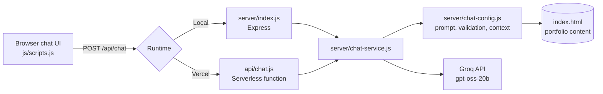

<div align="center">

# Athar Sayed — Portfolio

**AI/ML · Generative AI · Agentic AI**

A responsive, HUD-inspired developer portfolio with **IRIS**, an AI assistant that answers questions about my work, powered by Groq.

[**Live Site**](https://athar-sayed-portfolio.vercel.app/) · [**Resume**](./Athar-Sayed-Resume.pdf)


</div>

<!-- Add a screenshot or GIF of the site and the IRIS chat panel here, e.g.:

-->

## Table of Contents

- [Features](#features)
- [Architecture](#architecture)
- [Tech Stack](#tech-stack)
- [Getting Started](#getting-started)
- [API Reference](#api-reference)
- [Testing](#testing)
- [Deployment](#deployment)
- [Security](#security)
- [Project Structure](#project-structure)
- [Troubleshooting](#troubleshooting)

## Features

- **Complete portfolio** — Home, About, Projects, Experience, Skills, Publications, Certifications, Achievements, and Blog sections.
- **HUD-inspired interface** — responsive layout, boot-screen intro, section-navigation effects, and mobile navigation.
- **IRIS AI assistant** — a floating chat panel that answers questions about my skills, projects, experience, education, and achievements.
- **Grounded responses** — IRIS answers only from the portfolio content, does not invent personal details, and declines unrelated questions.
- **Server-side inference** — the Groq API key never reaches the browser.
- **One codebase, two runtimes** — the same chat service runs on a local Express server and as a Vercel serverless function.

## Architecture

IRIS loads the portfolio's public content from `index.html` on the server and passes it, with the user's question and conversation history, to Groq's `openai/gpt-oss-20b` model through the OpenAI-compatible Chat Completions API.



**Design notes**

- Grounding uses prompt-level context injection from the portfolio page, not vector retrieval. This keeps the system simple and is sufficient for the size of the content.
- Server-loaded content is the source of truth; browser-supplied context is ignored.
- `chat-service.js` handles timeouts, retries, and inference errors. `chat-config.js` handles system instructions, input and history validation, and response formatting.

## Tech Stack

| Layer | Technologies |
| --- | --- |
| Frontend | HTML, CSS, vanilla JavaScript |
| Backend | Node.js, Express |
| LLM inference | Groq (`openai/gpt-oss-20b`) via OpenAI-compatible Chat Completions |
| Hosting | Vercel (static site + serverless function) |
| Testing | PowerShell smoke-test script |

## Getting Started

### Prerequisites

- Node.js 18 or newer
- A [Groq API key](https://console.groq.com/) with access to the configured model

### Installation

```bash
git clone https://github.com/AtharSayed/athar-portfolio.git
cd athar-portfolio
npm --prefix server install
```

### Configuration

Create `server/.env`:

```dotenv
GROQ_API_KEY=your-groq-api-key
GROQ_MODEL_ID=openai/gpt-oss-20b   # optional
PORT=5173                          # optional
```

| Variable | Required | Default | Description |
| --- | :---: | --- | --- |
| `GROQ_API_KEY` | Yes | — | Server-side secret for authenticating with Groq |
| `GROQ_MODEL_ID` | No | `openai/gpt-oss-20b` | Model used for chat inference |
| `PORT` | No | `5173` | Port for the local Express server |

### Run

```bash
npm --prefix server start        # start the server
npm --prefix server run dev      # or: auto-restart on changes
```

Open <http://localhost:5173>. A health check is available at <http://localhost:5173/api/health>.

## API Reference

### `POST /api/chat`

Sends a question and optional conversation history to IRIS.

**Request**

```json
{
  "prompt": "What projects has Athar worked on?",
  "history": [
    { "role": "user", "content": "Tell me about your AI projects." }
  ]
}
```

`history` is optional. Each turn has a `role` of `user` or `assistant`.

**Response**

```json
{
  "reply": "A concise answer based on the portfolio content."
}
```

Malformed requests and missing credentials return error responses. Inference failures return a user-facing retry message.

### `GET /api/health`

Returns `{ "status": "ok" }` when the local server is running.

## Testing

With the local server running, execute the smoke-test script from the repository root:

```powershell
powershell -ExecutionPolicy Bypass -File .\test-chatbot.ps1
```

The script prints IRIS's replies for manual review across these categories:

- Portfolio questions and follow-ups
- Details not present in the portfolio
- Unrelated or out-of-scope requests
- Prompt-injection attempts

> This is a manual smoke test, not an automated test suite. It requires a valid Groq API key and may be affected by rate limits or model availability.

## Deployment

### Vercel

1. Import the repository into Vercel.
2. Add `GROQ_API_KEY` under **Settings → Environment Variables** (optionally `GROQ_MODEL_ID`).
3. Deploy, then verify the site and `POST /api/chat`.

`vercel.json` bundles `index.html` with the chat function so IRIS can load its context, and redirects `/server/` requests to the site root.

### Any Node.js host

Set `GROQ_API_KEY` in the host's environment settings, then run:

```bash
npm --prefix server install
npm --prefix server start
```

## Security

- The Groq API key is read only from server-side environment variables. Never commit `.env` files or expose keys in frontend code.
- IRIS is instructed to stay within portfolio topics, avoid unsupported personal claims, refuse to reveal its instructions, and never disclose credentials.
- Prompts and conversation history are validated on the server before reaching the model.

## Project Structure

```text
.
├── index.html            # Portfolio page, chat markup, and content used to ground IRIS
├── api/
│   └── chat.js           # Vercel serverless entry point for POST /api/chat
├── server/
│   ├── index.js          # Local Express server
│   ├── chat-service.js  # Model calls, timeouts, retries, error handling
│   ├── chat-config.js   # System prompt, context loading, validation, formatting
│   └── package.json
├── js/
│   ├── scripts.js        # Navigation and chat UI
│   └── hud-effects.js    # Boot screen and HUD effects
├── css/                  # styles.css, hud.css, chat-hud.css
├── images/               # Profile, project, and certificate assets
├── test-chatbot.ps1      # Manual chatbot smoke tests
├── vercel.json           # Vercel routing and function config
└── Athar-Sayed-Resume.pdf
```

## Troubleshooting

| Problem | Fix |
| --- | --- |
| `GROQ_API_KEY missing` | Create `server/.env` locally, or set the variable on your host, then restart or redeploy. |
| Port already in use | Set `PORT` to a free port. |
| Inference errors or rate limits | Check server logs, API-key permissions, model availability, and account quota, then retry later. |
| Site loads but chat is silent | Check `/api/health`, the browser Network tab, and the deployment function logs. |

---

<div align="center">

**Athar Sayed** · [Portfolio](https://athar-sayed-portfolio.vercel.app/) · [GitHub](https://github.com/AtharSayed)

</div>
